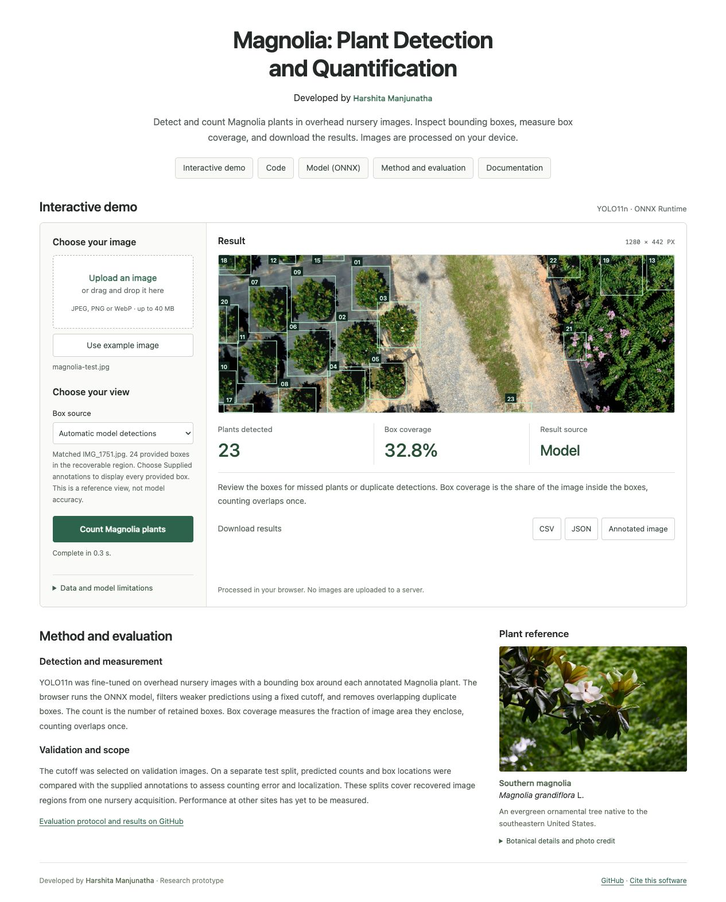

# Magnolia · Plant detection & quantification

**A computer vision research prototype developed by Harshita Manjunatha.**

Magnolia detection & quantification.

Magnolia turns overhead nursery imagery into inspectable plant detections, instance counts, and bounding-box coverage. A compact YOLO11n model runs directly in the browser through ONNX Runtime, keeping visitor images on their own devices. The interface puts the interactive demo first, with numbered boxes, traceable result sources, direct project resources, and measured evaluation results.

**[Open the research prototype](https://harshitha-8.github.io/magnolia_Quantification/)** · **[Deployment & Google Sites](DEPLOYMENT.md)** · **[Evaluation](reports/evaluation.json)**

**Research prototype · Computer vision · On-device inference · Open workflow**

This is experimental research software with measured limitations. Model predictions and provided reference annotations are explicitly distinguished throughout the interface and exports.

## Project description

> Magnolia is a browser-based research prototype for detecting and quantifying plants in overhead nursery imagery. Developed by Harshita Manjunatha, it combines a fine-tuned YOLO11n model with ONNX inference, visual inspection, bounding-box coverage, and downloadable results.

The static deployment follows the [Mildew Detector](https://github.com/samvadajainm/mildew-detector) pattern: a page and ONNX model hosted by GitHub Pages and embeddable in Google Sites.

Upload a JPEG/PNG/WebP or choose the held-out example, then select **Count Magnolia plants**. Download CSV, JSON, or the annotated image. Photos stay in browser memory; no inference server or API key is required.

## Using the published app

Use **https://harshitha-8.github.io/magnolia_Quantification/**, not a previous `127.0.0.1` preview tab. The permanent GitHub Pages app works without a local Python server. A localhost tab works only while its local preview server is running.

1. Choose a local JPEG, PNG, or WebP, or select the held-out example. Wait for the model-ready message, then choose **Count Magnolia plants**.
2. Boxes show plant numbers only. Mint boxes identify model predictions; warm gold boxes identify supplied reference annotations. Confidence percentages do not appear beside the boxes or in the main metrics.
3. The count button runs automatic detection at the fixed validation-selected cutoff (0.15), recorded in model exports.
4. For an exact supplied image or a prepared recovered crop, the **Supplied annotations (reference)** option becomes available. It displays every provided box in the recoverable region. The metric **Annotations displayed: 100%** means all those annotation boxes are visible. It is not model confidence, model accuracy, or proof that the annotation itself is exhaustive. It does not represent automatic detection.
5. CSV and JSON exports explicitly identify `model_predictions` or `provided_annotations`. Reference boxes have no fabricated confidence scores.

Known source files are recognized by SHA-256 content hashes, not filenames. A different or edited image with the same filename never inherits reference annotations. For known truncated originals, the app crops away the damaged lower rows and resizes the recovered region to 1280 pixels wide before prediction or reference display. Exported pixel coordinates refer to that working image, whose dimensions and source dimensions are included in JSON. Unknown images are processed at their original aspect ratio without this dataset-specific crop.

**100% automatic detection is not established.** The measured model errors below remain applicable; displaying every provided annotation cannot improve or replace those evaluation results. Evaluation covers the recovered image regions.

## What quantification means

- **Plant count:** the number of Magnolia detections after confidence filtering and non-maximum suppression. Partial visible plants at image edges may be counted.
- **Box coverage:** the union of all detection rectangles divided by image area; overlapping pixels are counted once.
- **Mean confidence (JSON export):** the average model score for retained detections; this is not a calibrated accuracy estimate.
- **Annotations displayed:** in the explicit reference view, the fraction of provided visible-region boxes rendered. The app shows all of them, so this is 100%; box coverage can still be much lower because plants do not occupy the entire image.

These annotations contain one object class, `Magnolia`, with bounding boxes. They do not label disease, leaves, canopy boundaries, or physical dimensions. Box coverage must not be reported as canopy cover, biomass, disease severity, or area in square metres.

## Data quality and validation

**All 298 original JPEGs supplied for this prototype are truncated.** Each stops before the full image is decoded. The preparation script detects missing lower scanlines, crops to recoverable upper content with a safety margin, clips the matching YOLO boxes, and removes four zero-area annotations. Neither gray decoder fill nor the existing `_annotated.jpg` visualizations are used for training.

The recovered regions contain approximately 43–56% of the original image height. The split uses contiguous acquisition blocks, with ten-image gaps between train/validation and validation/test: **208 training, 35 validation, 35 test, 20 excluded frames**. Full byte hashes and crop dimensions are recorded in [the dataset manifest](reports/dataset_manifest.csv). Sequential frames may still show the same plants. This is a same-nursery prototype evaluation, not an independent-site or independent-plant generalization test.

| Final test result | Value |
| --- | --- |
| Test images / annotated plants | 35 / 515 |
| Count mean absolute error at 15% confidence | 2.86 plants per image |
| Mean count bias | +1.77 plants per image |
| Detection mAP at IoU 0.50 | 0.600 |
| Detection mAP across IoU 0.50–0.95 | 0.340 |
| First test example | 23 predicted / 24 annotated |



Measured detection and count metrics are in [reports/evaluation.json](reports/evaluation.json); per-image count errors are in [reports/test_counts.csv](reports/test_counts.csv). AP metrics and count errors measure different things: count errors use the fixed 0.15 confidence threshold and 0.45 NMS IoU. Do not interpret mAP as counting accuracy. The default 0.15 confidence was selected by count MAE on the validation set only; see [threshold selection](reports/threshold_selection.json). The initial 0.35 test result is retained in [the baseline report](reports/baseline-evaluation-035.json).

**Next improvement:** obtain complete originals, rerun preparation and training, then validate on a separate nursery or flight with known plant counts. The existing model is useful for demonstrating the complete workflow, with manual review of detections.

## Repository layout

| File | Purpose |
| --- | --- |
| `index.html`, `styles.css`, `app.js` | Static browser interface and inference |
| `detector-core.js` | Letterbox geometry, output decoding, NMS, union coverage |
| `models/magnolia_detector.onnx` | Fine-tuned YOLO11n for browser inference |
| `models/magnolia_detector.pt` | Fine-tuned checkpoint for further training |
| `models/model.json` | Model contract, settings, hash and limitations |
| `vendor/` | Pinned ONNX Runtime Web 1.20.1, served locally |
| `scripts/prepare_dataset.py` | Source audit, recoverable crops, adjusted labels, split |
| `scripts/train.py` | Fine-tuning and ONNX export |
| `scripts/evaluate.py` | Held-out metrics and PyTorch/ONNX numerical comparison |
| `scripts/predict.py` | ONNX batch inference, counts, JSON and annotated images |
| `scripts/build_references.py`, `references/annotations.json` | Exact-file matches and clearly labeled provided annotation boxes |
| `reports/` | Audit, training history, evaluation and example predictions |
| `examples/` | First held-out test crop and corresponding YOLO annotations |
| `.github/workflows/pages.yml` | Tests and automatic GitHub Pages deployment |

## Local app

```bash
python3 -m http.server 8000
```

Open http://localhost:8000. JavaScript modules and ONNX loading require HTTP; double-clicking the HTML file is insufficient. No Node packages or frontend build are needed.

## Reproduce training and export

Use Python 3.12, with enough free space for a local dataset. The original dataset is not included in Git.

```bash
python3.12 -m venv .venv
source .venv/bin/activate
pip install -r requirements.txt
python scripts/prepare_dataset.py \
  --source '/Volumes/T9/CVPR 2027/Data/Magnolia_RGB' \
  --output data/magnolia
python scripts/train.py --data data/magnolia/magnolia.yaml --epochs 30 --device cpu
python scripts/calibrate.py --data data/magnolia/magnolia.yaml --device cpu
python scripts/evaluate.py --data data/magnolia/magnolia.yaml --device cpu
python scripts/build_references.py --source '/Volumes/T9/CVPR 2027/Data/Magnolia_RGB'
npm test
```

Use `--device mps` on supported Apple Silicon or `--device 0` for an NVIDIA GPU. The initial pretrained `yolo11n.pt` is downloaded by Ultralytics. Seeds are fixed, but GPU operations may not be bitwise deterministic. Training refuses to overwrite an existing run directory; choose a new `--project` for another run.

If recalibration on a new dataset selects another cutoff, pass it to evaluation and prediction with `--confidence` and update `MODEL_CONFIDENCE` in `app.js`. The shipped model uses 0.15.

## Batch quantification

```bash
python scripts/predict.py examples/magnolia-test.jpg --output predictions
python scripts/predict.py /path/to/complete/images --confidence 0.15 --output predictions
```

This uses ONNX Runtime on CPU. It writes per-image JSON and annotated JPEGs plus `summary.csv`. It refuses incomplete JPEGs; for the supplied dataset, run it on the prepared recovered crops instead.

## Collaborator handoff

See [DEPLOYMENT.md](DEPLOYMENT.md) for GitHub Pages setup, Google Sites embedding, and the exact model integration contract. This model uses **640×640 RGB letterbox, NCHW float32 /255**, unlike the Mildew Detector classifier. The interface supports Google Sites iframes without cross-origin isolation.

The original app code retains this repository's MIT license. The Ultralytics model is subject to AGPL-3.0 or a separate enterprise license; see [THIRD_PARTY_NOTICES.md](THIRD_PARTY_NOTICES.md).

## Attribution & citation

**Developed by Harshita Manjunatha.**

If you use this prototype in a demonstration, report, or research workflow, credit the project and link to this repository. A machine-readable software citation is provided in [CITATION.cff](CITATION.cff). No associated peer-reviewed publication or independent-site validation is claimed.

```text
Manjunatha, Harshita (2026). Magnolia: Plant detection and quantification
[Research prototype]. https://github.com/harshitha-8/magnolia_Quantification
```

## Botanical profile & interface

A plant-reference column below the demo introduces Southern magnolia (*Magnolia grandiflora* L., family Magnoliaceae) using a credited botanical photograph and facts sourced from [NC State Extension](https://plants.ces.ncsu.edu/plants/magnolia-grandiflora/) and [Oregon State University](https://landscapeplants.oregonstate.edu/plants/magnolia-grandiflora). This educational profile does not establish the species of the dataset plants: the detector has one class, `Magnolia`.

Developer attribution appears in two visible places: the introduction and footer. The interface uses readable workspace labels and result notes, a plain-language explanation of the method and validation protocol, and a link to the detailed evaluation. The original model and reference-annotation behavior are preserved.

Photo credit and asset provenance are documented in [THIRD_PARTY_NOTICES.md](THIRD_PARTY_NOTICES.md).

## Research-demo presentation

The page uses a compact project title, developer attribution, direct Code / ONNX / Evaluation / Documentation links, and an interactive image-to-result workspace. The oversized hero, slogans, decorative feature strip, and promotional cards have been removed. The plant-reference column displays a full-width photograph with expandable botanical details and credits.

See [DESIGN_REFERENCES.md](DESIGN_REFERENCES.md) for the CVPR, NeurIPS, ACL, and ICLR project pages reviewed for this redesign. Layout code is original; the prototype makes no conference-acceptance or award claim.
